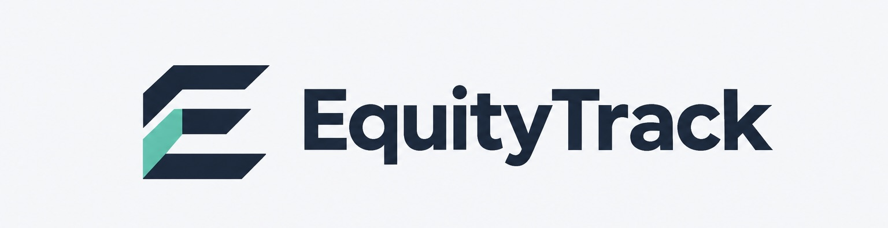

<div align="center">
  

  ### Las oportunidades también cuentan

  **Una herramienta para detectar diferencias, revisar oportunidades y dar seguimiento a las decisiones.**

  `Python` · `JavaScript` · `SQLite` · `API Gemini`
</div>

---

## El proyecto

En una evaluación de ascenso, ¿cómo sabemos si una persona ha tenido oportunidades para demostrar lo que se le exige?

**EquityTrack** ayuda a los equipos de Recursos Humanos a explorar esta pregunta. Reúne información sobre salarios, promociones, permisos y oportunidades profesionales para facilitar una revisión documentada y la creación de medidas de seguimiento.

La aplicación utiliza datos de ejemplo. **Recursos Humanos define los criterios y toma las decisiones**: los resultados son señales para revisar, no pruebas automáticas de discriminación ni decisiones de ascenso.

## ¿Qué permite hacer?

| Función | Para qué sirve |
| --- | --- |
| **Datos de plantilla** | Cargar un CSV o explorar la plantilla ficticia incluida. |
| **Brecha salarial** | Comparar las medias de salario fijo y variable por departamento y categoría. |
| **Promociones** | Comparar las tasas de ascenso desde cada nivel de partida. |
| **Permisos de cuidados** | Revisar cambios salariales y de responsabilidad frente a un grupo de referencia. |
| **Oportunidades de ascenso** | Revisar requisitos, evidencias y oportunidades en un expediente ficticio. |
| **Acciones e informes** | Registrar medidas, responsables y fechas; descargar el resultado de la revisión. |
| **Asistente con Gemini** | Formular preguntas sobre los resultados agregados. |

Las comparaciones son descriptivas: compartir categoría no garantiza que dos puestos sean equivalentes. La comparabilidad y las causas de las diferencias deben revisarse antes de sacar conclusiones.

## Cómo empezar

Necesitas **Python 3.9 o posterior**. La aplicación no requiere instalar librerías externas de Python.

```bash
# 1. Descarga el repositorio
git clone https://github.com/EquityTeamTrack/EquityTrack.git

# 2. Entra en la carpeta
cd EquityTrack

# 3. Inicia la aplicación
python3 app.py
```

Abre **[http://127.0.0.1:8080](http://127.0.0.1:8080)** en tu navegador. Mantén la terminal abierta mientras uses la aplicación. Para detenerla, pulsa `Ctrl + C`.

Si el puerto 8080 está ocupado, puedes elegir otro:

```bash
python3 app.py --port 8093
```

Después abre [http://127.0.0.1:8093](http://127.0.0.1:8093).

## Configurar el asistente de Gemini

El resto de la aplicación puede usarse sin configurar el chatbot. Para activarlo:

1. Crea una clave en [Google AI Studio](https://aistudio.google.com/apikey).
2. En la carpeta del proyecto, copia la plantilla:

   ```bash
   cp .env.example .env
   ```

3. Abre `.env` y añade tu clave. Puedes utilizar `nano .env` desde la terminal:

   ```text
   GEMINI_API_KEY=tu_clave_aqui
   GEMINI_MODEL=gemini-3.1-flash-lite
   ```

4. Guarda el archivo y reinicia `python3 app.py`. Abre el asistente con el botón situado abajo a la derecha.

El modelo se puede cambiar en `.env`. Su disponibilidad depende de la cuenta de Google. La clave se lee desde Python y **no se envía al navegador**.

> **Para GitHub:** sube `.env.example`, pero nunca `.env` ni tu clave real. El archivo `.gitignore` ya excluye `.env`.

Al enviar una pregunta, Google Gemini recibe la consulta, el historial reciente y un resumen agregado del filtro seleccionado. No se envían las filas individuales del CSV ni los textos del expediente. Los grupos pequeños se excluyen del resumen; evita incluir datos personales en tus preguntas o en las etiquetas de los datos.

## Tecnologías

- **Python:** servidor local, API y gestión del expediente de ascenso.
- **SQLite:** almacenamiento local de evidencias, revisiones y medidas del expediente.
- **HTML, CSS y JavaScript:** interfaz y cálculos de los análisis de plantilla.
- **Gemini API:** respuestas del asistente sobre los resultados agregados.

La plantilla CSV importada permanece en memoria y debe volver a cargarse al recargar la página. Las medidas generales del panel se guardan en el navegador; las del expediente ficticio se guardan en SQLite.

## Organización del proyecto

```text
EquityTrack/
├── app.py                 # Servidor y API local
├── gemini_api.py          # Conexión con Gemini
├── index.html             # Estructura de la aplicación
├── .env.example           # Plantilla de configuración sin credenciales
├── assets/                # Identidad visual
├── data/                  # Datos de ejemplo y fuentes de referencia
├── equitytrack/           # Reglas y almacenamiento en Python
├── src/                   # Interfaz, análisis y chatbot
└── tests/                 # Pruebas del proyecto
```

## Ejecutar las pruebas

```bash
# Pruebas de Python y de la API
python3 -m unittest discover -s tests -v

# Comprobaciones de la interfaz y los cálculos; requiere Node.js
npm run check
```

Las pruebas de Gemini usan respuestas simuladas y no necesitan una clave real.

## Alcance actual

- La conexión con sistemas de nóminas es una **simulación**.
- El expediente de ascenso es un caso ficticio independiente del CSV de plantilla.
- Los roles mostrados en el expediente son de prueba; no hay autenticación real ni aislamiento entre empresas.
- Los informes sirven de apoyo y requieren revisión profesional antes de su uso oficial.
- La versión completa necesita un servidor que ejecute Python; GitHub Pages por sí solo no ejecuta esa parte.

## Fuentes de referencia

La propuesta inicial de criterios se inspira en los artículos 11 y 15 del [XIX Convenio estatal de consultoría y tecnologías de la información](https://www.boe.es/eli/es/res/2025/04/04/%2810%29), firmado por CCOO y UGT. Recursos Humanos y el área técnica deben verificar el convenio aplicable y adaptar los criterios a la empresa.

Las referencias estadísticas del INE y los documentos consultados están recogidos en `data/reference-framework.json`.

---

<div align="center"><strong>EquityTrack · Oportunidades para que el talento avance</strong></div>
